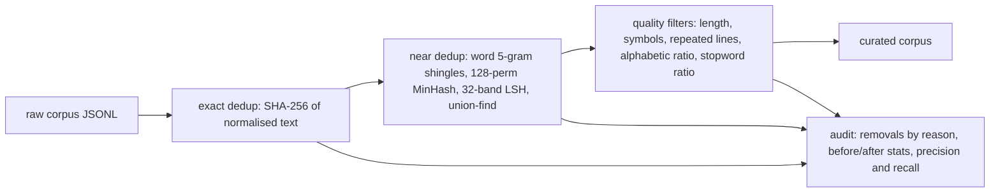

# Text Dedup & Quality Pipeline

[](https://github.com/Saigwe/text-dedup-quality-pipeline/actions/workflows/ci.yml)
 

Curation for text datasets, as used to prepare AI training data: exact deduplication, near-duplicate detection with **MinHash + LSH** written from scratch in NumPy, heuristic quality filters, and an audit that explains every removal.



## Results on the labelled synthetic corpus

The built-in corpus has 550 documents: 400 originals, 40 exact copies (case and whitespace changed), 60 near-copies (3 words changed) and 50 junk documents. Because every record is labelled, the pipeline is **scored**, not eyeballed:

| Metric | Value |
|---|---|
| Documents kept | 405 of 550 |
| Precision of removals | **100%** |
| Recall of removals | **96.7%** (5 near-copies fell under the 0.7 similarity threshold) |

Scoring treats each source document and its copies as one cluster where exactly one member should survive. It doesn't matter which one, so keeping a copy and dropping the original is not counted as an error.

See [`output/audit.md`](output/audit.md) for removals by reason and one example of each.

## Design choices

- **Cheapest checks first.** Exact hashing removes trivial copies before the more expensive MinHash step.
- **LSH banding** (32 bands × 4 rows) only compares documents that share a band, avoiding all-pairs comparison. Candidates are then confirmed against the estimated Jaccard threshold.
- **Reason codes everywhere**, so the audit can show exactly why each document was removed, and thresholds can be tuned per reason.
- **Threshold trade-off.** Lowering the 0.7 threshold catches more near-copies but risks merging distinct documents that share boilerplate. This is the main tuning decision.

## Run it

```bash
pip install -r requirements.txt
python -m dedup.audit                                  # synthetic labelled corpus
python -m dedup.audit --input my_corpus.jsonl          # your own JSONL with a "text" field
pytest
```

Next step: apply it to a public corpus (for example a Wikipedia sample, noting its licence) and port the MinHash step to PySpark for scale.

## Stack

Python, NumPy (vectorised MinHash), pytest.
