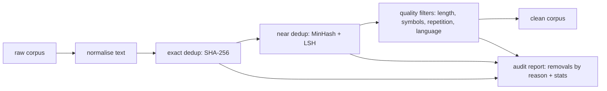

# Text Dedup & Quality Pipeline (scaffold)

> **Status: scaffold.** Structure and interfaces are in place; the steps in the checklist below are still to do.

**Gap it closes:** large-scale data curation for AI training data: deduplication, quality filtering and
dataset audits, in Python (pandas/NumPy) and optionally PySpark. Asked for by Microsoft AI (Pretraining
Data) and other AI-data roles.

## Goal

Take a public text corpus, remove exact and near duplicates, apply heuristic quality filters, and publish
an audit showing what was removed and why, plus before/after dataset statistics.

## Checklist

- [ ] Pick a public corpus (for example a Wikipedia or news sample) and record its licence in `DATA.md`
- [ ] `dedup/normalise.py`: unicode normalisation, whitespace, case
- [ ] `dedup/exact.py`: hash-based exact dedup (implemented, see tests)
- [ ] `dedup/minhash.py`: shingling, MinHash signatures and LSH banding; tune the Jaccard threshold
- [ ] `dedup/filters.py`: length, symbol ratio, repeated-line ratio and language heuristics, each with a reason code
- [ ] `dedup/audit.py`: removals by reason, length distributions, sample of removed documents
- [ ] Optional: PySpark version of the MinHash step for scale
- [ ] README: precision check on a hand-labelled sample of near-duplicate pairs
